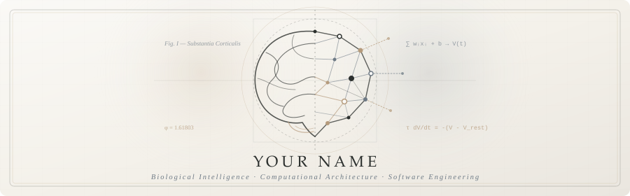

  

  

  
  

  <em>"The mind is not a vessel to be filled, but a complex architecture to be modeled."</em>

---

### 🏛️ Disciplines & Instruments

**Computational Modeling & Research**

  

**Software Architecture & Systems**

  

---

  

